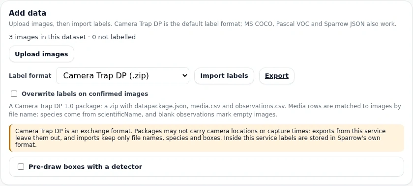
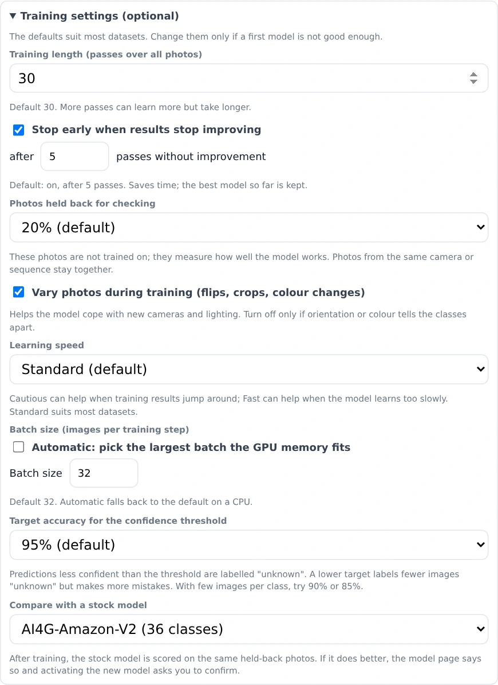
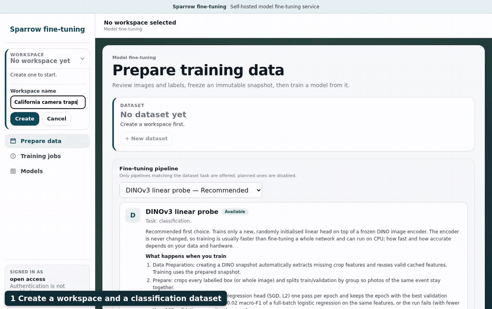
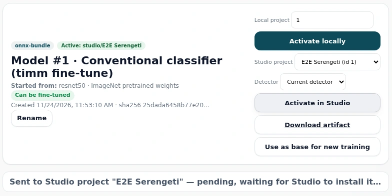

# SPARROW Fine-Tune

SPARROW Fine-Tune is a toolkit for conservation and ecology practitioners to fine-tune
AI animal recognition models on their own camera-trap datasets without writing code.
In your browser, you can review labels, train a model to detect animals or identify
species, and check its results on held-out photos.

[Screenshots](#a-look-inside) · [Quick start](#quick-start) · [Choose a pipeline](#choose-a-pipeline) · [Studio release preview](#future-release-with-sparrow-studio) · [User manual](docs/user-manual.md)

### 🔗 Why a separate app, and how Studio fits

Fine-Tune runs on its own so you can train on local photos and download your model
without a Sparrow Studio project. Studio features are off in this release.
We plan to include the full training workflow in a [future Sparrow Studio release](#future-release-with-sparrow-studio).

## 📷 A look inside

### 📂 Prepare training data

<a href="docs/media/add-data.webp"></a>

In **Add data**, choose **Upload images** to add your photos. If you have annotations,
select their format and choose **Import labels**. You can also use an installed detector
to draw initial boxes for review.

### 🔍 Review an individual photo

<a href="docs/media/workflow-tour.gif"></a>

Check the box and species label on each photo. You can correct either before training.
The animation shows annotations from the original dataset.

Field photographs: [Caltech Camera Traps](https://lila.science/datasets/caltech-camera-traps/),
[CDLA-Permissive 1.0](https://cdla.dev/permissive-1-0/).
[Deer](https://storage.googleapis.com/public-datasets-lila/caltech-unzipped/cct_images/59b7a938-23d2-11e8-a6a3-ec086b02610b.jpg)
and [bobcat](https://storage.googleapis.com/public-datasets-lila/caltech-unzipped/cct_images/59aadcc0-23d2-11e8-a6a3-ec086b02610b.jpg): Justin Brown.
[Coyote](https://storage.googleapis.com/public-datasets-lila/caltech-unzipped/cct_images/58a52f6e-23d2-11e8-a6a3-ec086b02610b.jpg): Erin Boydston.

### 🎛 Configure your training parameters

You can start with the defaults. We kept **Training settings (optional)** to the basics
most projects need, so you don’t need a machine learning background to train a model.
The controls depend on the pipeline. For example, you can choose how many passes to make
over the photos, when to stop if results stop improving, or what share of photos to hold
back for checking the model.

<a href="docs/media/training-settings.webp"></a>

### 📊 Training jobs and models

| Follow a training job | Decide what to do with a model |
|---|---|
| [](docs/media/training-job.webp) | [](docs/media/model-card.webp) |
| Follow the training curves and check the export status. | Check **Started from**, the validation scores and the confidence threshold. [Open all metrics: version comparison and version record](docs/media/model-results.webp). |

These screenshots show test runs on other data. The model card comes from a Studio-connected
test build; the standalone release has no Studio controls. The scores do not measure accuracy on the photos above.

**Compare model versions.** A new run keeps the previous model. In **Models → Compare
with another version**, select your current model to compare its saved scores with the new
model’s scores. The table does not rerun either model. Before switching, test both on the
same held-out photos and compare results for the species you monitor.

**Check for drift.** To check whether a detector misses more deer after a camera moves,
use the same model on reviewed photos from before and after the move. For each period,
compare the fraction of labelled deer the model found. Fine-Tune does not monitor
deployed models or send drift alerts.

## 🚀 Quick start

Install Docker with Compose v2 on the machine you’ll use for training. **The quick start
trains on CPU**, even on a machine with a GPU. To train an image classifier or detector
on NVIDIA hardware, follow [Train on an NVIDIA GPU](#train-on-an-nvidia-gpu).

```bash
git clone https://github.com/microsoft/SPARROW-Fine-Tune.git
cd SPARROW-Fine-Tune
cp .env.service.example .env.service
```

In `.env.service`, change `POSTGRES_PASSWORD` from `change-me` to a private password.
Add `TORCH_VARIANT=cpu`. Keep the file private, then start Fine-Tune:

```bash
docker compose -f compose.service.yml --env-file .env.service up -d --build --wait
curl -fsS http://127.0.0.1:8000/v1/health
```

When the health check returns `{"status":"ok","database":"ok"}`, open **<http://127.0.0.1:8000/>**.
**For the recommended DINOv3 pipeline**, [download and configure the encoder](#set-up-the-dinov3-encoder)
before creating your first snapshot. Fine-Tune does not download it for you.
To train without it, choose **Conventional classifier** before creating a snapshot. The first run needs internet access
to download ImageNet weights unless you [supply local weights](docs/user-manual.md#3-model-weights).

> [!IMPORTANT]
> Sign-in is off by default. Keep the app on `127.0.0.1` for local use. To turn sign-in on,
> change `SPARROW_FT_AUTH_DISABLED` from `1` to `0` in `.env.service`, then
> [apply the change and create your first account](#enable-sign-in).
> Before sharing the app, put it behind an HTTPS reverse proxy. Signed-in users share workspaces.

## 🧭 Choose a pipeline

| Task | Pipeline | Training setup |
|---|---|---|
| Identify species in animal crops | **DINOv3 linear** (recommended; [one-time setup](#set-up-the-dinov3-encoder)) | Keep the encoder fixed and train a new classification layer on the saved crop features. No GPU required. |
| Identify species in crops or whole photos | **Image classifier** | Start with **ResNet-50** or **EfficientNet-B0** pretrained on ImageNet. We recommend a GPU. |
| Locate animals in photos | **YOLO11 detector** | Create a **Detection** dataset and train on reviewed bounding boxes. We recommend a GPU. |

**Model Zoo** downloads in ONNX format are for running predictions. They do not include
the original training weights. Start with a classifier option above or reuse a compatible
classifier you trained in Fine-Tune.

## 🧠 Train your first model

Watch the five steps below in a standalone Fine-Tune workspace. The recording uses 12
bobcat and coyote photos and two training passes to show the controls, not to measure
field accuracy. The training wait is cut out.

<a href="docs/media/first-model.gif"></a>

Photos: Justin Brown and Erin Boydston, [Caltech Camera Traps](https://lila.science/datasets/caltech-camera-traps/),
[CDLA-Permissive 1.0](https://cdla.dev/permissive-1-0/).

1. **Create a dataset.** In **Prepare data**, create a workspace and select **+ New dataset**.
   Choose *Classification* to identify species or *Detection* to locate animals. Turning off
   whole-image training changes a classifier’s input to crops; it does not select detection.
2. **Add photos and labels.** Label uploaded photos in the browser or import COCO, Pascal VOC
   or Camtrap DP annotations. For animal crops, draw missing boxes or review boxes suggested
   by an installed detector.
3. **Select a pipeline and save the training examples.** Click **Create immutable snapshot**.
   With DINO, each image shows **Pending feature** or **Feature extracted**. The progress
   pane counts new and reused crop features. If all features are valid, there is nothing
   to extract. Other pipelines do not use DINO features.
4. **Train and check the results.** Start training and follow progress in **Jobs**. In **Models**, check results by species.
   For a classifier, the confusion matrix shows which species it mixed up. If you selected
   a stock classifier, check whether your model improved on it.
5. **Download or retrain.** Download the model as an ONNX bundle. To train a finished
   classifier on new data or with different settings, select **Use as base for new training**.
   The preview lists the weights you can reuse. The new model card names the parent under
   **Started from**; the parent stays unchanged.

## 🔭 Future release with Sparrow Studio

We plan to let Studio users train on reviewed project photos and install the resulting
model in the same project. The screenshots below show a development build. These controls
are off in the standalone release.

**Import reviewed photos.** Open **Model fine-tune** from a Studio project. Choose
**Import from Studio** with **Reviewed only** selected. The example shows 40 reviewed
images imported without copying files by hand.

[](docs/media/studio-reviewed-import.webp)

**Send a model to Studio.** Training a new version leaves the project’s current model
in place. To use the new version, select the model and project, then choose **Activate
in Studio**. The screenshot shows the classifier waiting for installation.

[](docs/media/studio-send-model.webp)

## 🔧 Configure your installation

### Train on an NVIDIA GPU

Install a compatible NVIDIA driver and the [NVIDIA Container Toolkit](https://docs.nvidia.com/datacenter/cloud-native/container-toolkit/latest/install-guide.html) on the training machine. Keep `TORCH_VARIANT=cpu` for the CPU services. In `.env.service`, set `SPARROW_FT_GPU_PIPELINES=yolo_detector,conventional_classifier`. Then start the additional CUDA worker and check that PyTorch can see your GPU:

```bash
docker compose -f compose.service.yml --env-file .env.service --profile gpu up -d --build --wait
docker compose -f compose.service.yml --env-file .env.service exec worker-gpu \
  python -c 'import torch; print(torch.cuda.get_device_name(0))'
```

The second command should print your GPU name. Image-classifier and detector jobs now wait for a GPU worker rather than falling back to CPU. Leave `SPARROW_FT_GPU_PIPELINES` empty on CPU-only installations. The local DINO encoder and linear-head training use CPU; enabling the GPU worker does not change that.

### Set up the DINOv3 encoder

Do this once on the training machine, before creating a DINO snapshot:

1. Sign in to Hugging Face and request access to [Meta’s DINOv3 ViT-S/16 weights](https://huggingface.co/facebook/dinov3-vits16-pretrain-lvd1689m). Once approved, install [uv](https://docs.astral.sh/uv/getting-started/installation/) and run these commands **from the Fine-Tune repository folder**. Sign in with the approved account. The export command downloads the weights, converts them to ONNX and checks the output against the original model.

   ```bash
   uvx --from huggingface_hub hf auth login
   uv run --locked --with transformers python scripts/e2e/export_dinov3_onnx.py \
     --out "$HOME/sparrow-encoders/dinov3_vits16.onnx"
   ```

2. Keep the `.onnx` file and its `.onnx.data` file together. The container user needs read access to both files and access to their directory. In `.env.service`, set `SPARROW_FT_EMBEDDER=onnx:/encoders/dinov3_vits16.onnx`. Save the following as `compose.encoder.yml` beside `compose.service.yml`:

   ```yaml
   x-encoder: &encoder
     volumes: ["${HOME}/sparrow-encoders:/encoders:ro"]
   services:
     api: *encoder
     worker-cpu: *encoder
     worker-gpu: *encoder
   ```

3. Apply the configuration. Include `-f compose.encoder.yml` whenever you start or recreate these services. If you also use the GPU worker, add `--profile gpu` before `up`.

   ```bash
   docker compose -f compose.service.yml -f compose.encoder.yml --env-file .env.service up -d --build --wait
   ```

   In **Prepare data**, select **DINOv3 linear** and create a snapshot with labeled crops. Wait for **Feature extracted** before starting training. You do not need a Hugging Face token in the running service.

### 🔐 Enable sign-in

In `.env.service`, set `SPARROW_FT_AUTH_DISABLED=0`. Leave `SPARROW_FT_COOKIE_SECURE=0`
for local HTTP. If users connect through an HTTPS reverse proxy, set `SPARROW_FT_COOKIE_SECURE=1`.
From the repository folder, run these Bash commands to apply the change and create the `admin`
account. Enter a password of at least eight characters at the prompt:

```bash
docker compose -f compose.service.yml --env-file .env.service up -d
read -rs -p 'New admin password: ' password; echo
printf '%s\n' "$password" | docker compose -f compose.service.yml --env-file .env.service exec -T api sparrow-finetune create-user admin
unset password
```

Open the app in a private browser window and sign in as `admin` with the password you chose.

## 💻 Development

The FastAPI service and workers use the same PostgreSQL database and data volume.
Open the [API reference](http://127.0.0.1:8000/docs) on your running installation to
inspect the routes. To run the tests, install `uv` and Docker, then run:

```bash
uv sync --extra dev --extra export --extra e2e
uv run --no-sync playwright install chromium
uv run --no-sync python -m pytest -q tests
```

The [user manual](docs/user-manual.md) covers service operations, API routes and the
legacy YOLO workbench. For help, see [Support](SUPPORT.md). To report a security issue,
follow the [security policy](SECURITY.md).

## 🤝 Contributing

This project welcomes contributions and suggestions.  Most contributions require you to agree to a
Contributor License Agreement (CLA) declaring that you have the right to, and actually do, grant us
the rights to use your contribution. For details, visit [Contributor License Agreements](https://cla.opensource.microsoft.com).

When you submit a pull request, a CLA bot will automatically determine whether you need to provide
a CLA and decorate the PR appropriately (e.g., status check, comment). Simply follow the instructions
provided by the bot. You will only need to do this once across all repos using our CLA.

This project has adopted the [Microsoft Open Source Code of Conduct](https://opensource.microsoft.com/codeofconduct/).
For more information see the [Code of Conduct FAQ](https://opensource.microsoft.com/codeofconduct/faq/) or
contact [opencode@microsoft.com](mailto:opencode@microsoft.com) with any additional questions or comments.
