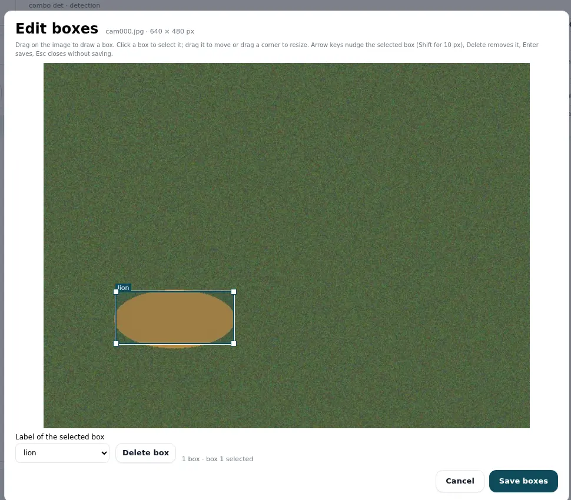
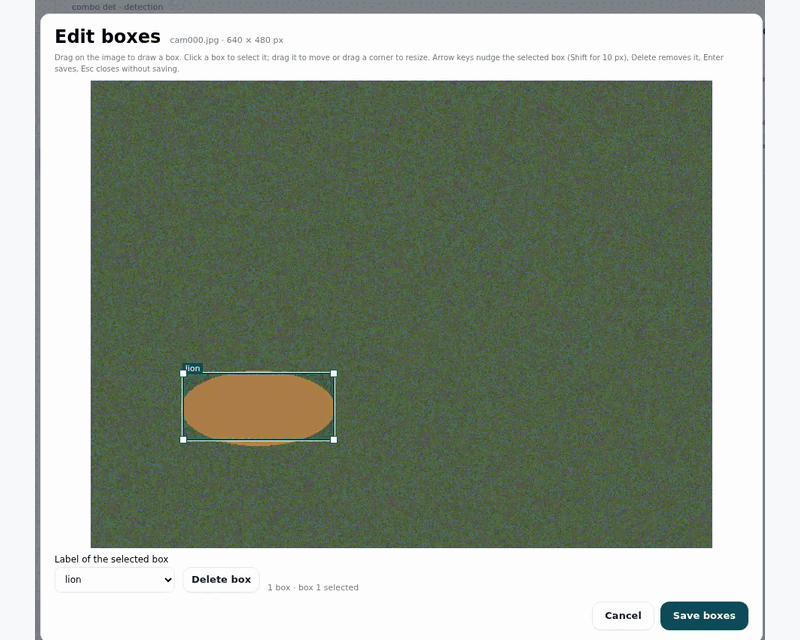
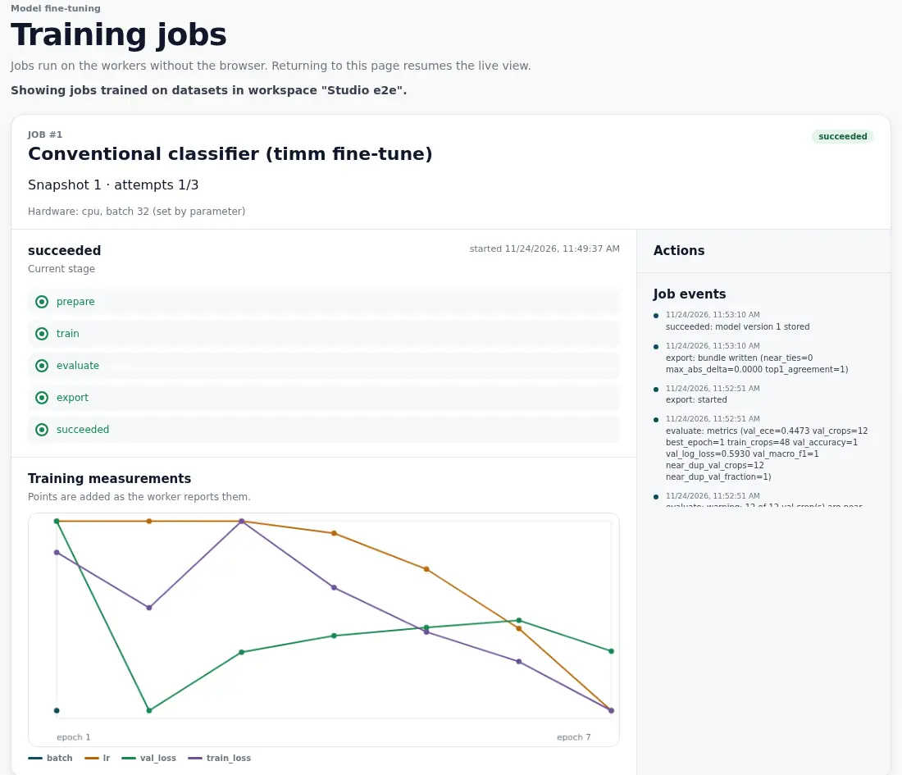
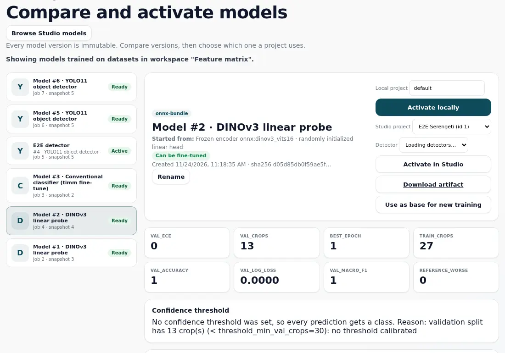

# SPARROW Fine-Tune

SPARROW Fine-Tune is a toolkit for conservation and ecology practitioners to fine-tune
AI animal recognition models on their own camera-trap datasets without writing code.
In your browser, you can review labels, train a model to detect animals or identify
species, and check its results on held-out photos.

[Screenshots](#a-look-inside) · [Quick start](#quick-start) · [Choose a pipeline](#choose-a-pipeline) · [Studio release preview](#future-release-with-sparrow-studio) · [User manual](docs/user-manual.md)

### 🔗 Why a separate app, and how Studio fits

Fine-Tune runs on its own so you can train on local photos and download your model
without a Sparrow Studio project. Studio features are off in this release.
We plan to include the full training workflow in a [future Sparrow Studio release](#future-release-with-sparrow-studio).

## 📷 A look inside

### 📂 Prepare training data

<a href="docs/media/prepare-data.webp"></a>

Choose your dataset and training pipeline at the top of the page. Under **Review the
training examples**, confirm or correct labels, or exclude a photo from training. For classifiers that
use animal crops, check **Training snapshot** for photos that still need a box.

### 🔍 Review an individual photo

<a href="docs/media/review-boxes.webp"></a>

*The editor shows the deer’s box and species label from the original dataset. You can
change either before training.*

<details>
<summary><strong>See three annotated camera-trap photographs</strong> (animated GIF)</summary>



</details>

Field photographs: [Caltech Camera Traps](https://lila.science/datasets/caltech-camera-traps/),
[CDLA-Permissive 1.0](https://cdla.dev/permissive-1-0/).
[Deer](https://storage.googleapis.com/public-datasets-lila/caltech-unzipped/cct_images/59b7a938-23d2-11e8-a6a3-ec086b02610b.jpg)
and [bobcat](https://storage.googleapis.com/public-datasets-lila/caltech-unzipped/cct_images/59aadcc0-23d2-11e8-a6a3-ec086b02610b.jpg): Justin Brown.
[Coyote](https://storage.googleapis.com/public-datasets-lila/caltech-unzipped/cct_images/58a52f6e-23d2-11e8-a6a3-ec086b02610b.jpg): Erin Boydston.

| Follow a training job | Decide what to do with a model |
|---|---|
| [](docs/media/training-job.webp) | [](docs/media/model-card.webp) |
| Follow the training curves and check the export status. | **Started from** shows the starting weights, including the parent model if you retrained a classifier. |

These two screenshots show test runs on other data. The scores do not measure accuracy on the photos above.

**Compare model versions.** A new run keeps the previous model. In **Models → Compare
with another version**, select your current model to compare its saved scores with the new
model’s scores. The table does not rerun either model. Before switching, test both on the
same held-out photos and compare results for the species you monitor.

**Check for drift.** To check whether a detector misses more deer after a camera moves,
use the same model on reviewed photos from before and after the move. For each period,
compare the fraction of labelled deer the model found. Fine-Tune does not monitor
deployed models or send drift alerts.

## 🚀 Quick start

Install Docker with Compose v2 on the machine you’ll use for training. The CPU setup runs
the app, database and training worker on that machine without Studio or a GPU.

```bash
git clone https://github.com/microsoft/SPARROW-Fine-Tune.git
cd SPARROW-Fine-Tune
cp .env.service.example .env.service
```

In `.env.service`, change `POSTGRES_PASSWORD` from `change-me` to a private password.
Add `TORCH_VARIANT=cpu`. Keep the file private, then start Fine-Tune:

```bash
docker compose -f compose.service.yml --env-file .env.service up -d --build --wait
curl -fsS http://127.0.0.1:8000/v1/health
```

When the health check returns `{"status":"ok","database":"ok"}`, open **<http://127.0.0.1:8000/>**.
The default installation does not include a DINO encoder. To train a classifier without one,
choose **Image classifier** before creating a snapshot. The first run needs internet access
to download ImageNet weights unless you [supply local weights](docs/user-manual.md#3-model-weights).

> [!IMPORTANT]
> Sign-in is off by default. Keep the app on `127.0.0.1` for local use. Before giving
> others access, enable sign-in and use an HTTPS reverse proxy. Users share the workspaces
> on the same installation.

## 🧭 Choose a pipeline

| Task | Pipeline | Training setup |
|---|---|---|
| Identify species in animal crops | **DINOv3 linear** (recommended if you have an encoder) | Keep the encoder fixed and train a new classification layer on the saved crop features. This step can run on CPU. |
| Identify species in crops or whole photos | **Image classifier** | Start with **ResNet-50** or **EfficientNet-B0** pretrained on ImageNet. We recommend a GPU. |
| Locate animals in photos | **YOLO11 detector** | Create a **Detection** dataset and train on reviewed bounding boxes. We recommend a GPU. |

**Model Zoo** downloads in ONNX format are for running predictions. They do not include
the original training weights. Start with a classifier option above or reuse a compatible
classifier you trained in Fine-Tune.

## 🧠 Train your first model

1. **Create a dataset.** In **Prepare data**, create a workspace and select **+ New dataset**.
   Choose *Classification* to identify species or *Detection* to locate animals. Turning off
   whole-image training changes a classifier’s input to crops; it does not select detection.
2. **Add photos and labels.** Label uploaded photos in the browser or import COCO, Pascal VOC
   or Camtrap DP annotations. For animal crops, draw missing boxes or review boxes suggested
   by an installed detector.
3. **Select a pipeline and save the training examples.** Click **Create immutable snapshot**.
   With DINO, each image shows **Pending feature** or **Feature extracted**. The progress
   pane counts new and reused crop features. If all features are valid, there is nothing
   to extract. Other pipelines do not use DINO features.
4. **Train and check the results.** Start training and follow progress in **Jobs**. In **Models**, check results by species.
   For a classifier, the confusion matrix shows which species it mixed up. If you selected
   a stock classifier, check whether your model improved on it.
5. **Download or retrain.** Download the model as an ONNX bundle. To train a finished
   classifier on new data or with different settings, select **Use as base for new training**.
   The preview lists the weights you can reuse. The new model card names the parent under
   **Started from**; the parent stays unchanged.

## 🔭 Future release with Sparrow Studio

We plan to let Studio users train on reviewed project photos and install the resulting
model in the same project. The screenshots below show a development build. These controls
are off in the standalone release.

**Import reviewed photos.** Open **Model fine-tune** from a Studio project. Choose
**Import from Studio** with **Reviewed only** selected. The example shows 40 reviewed
images imported without copying files by hand.

[](docs/media/studio-reviewed-import.webp)

**Send a model to Studio.** Training a new version leaves the project’s current model
in place. To use the new version, select the model and project, then choose **Activate
in Studio**. The screenshot shows the classifier waiting for installation.

[](docs/media/studio-send-model.webp)

## 🔧 Configure your installation

| Option | Setup |
|---|---|
| **DINO features** | Mount the same compatible encoder read-only in the API and preparation worker. Use the same path in both containers. In `.env.service`, set `SPARROW_FT_EMBEDDER=onnx:/weights/encoder.onnx`, substituting your encoder’s path. See the [Compose mount example](docs/user-manual.md#3-model-weights). |
| **NVIDIA GPU** | Install the NVIDIA Container Toolkit. In `.env.service`, set `SPARROW_FT_GPU_PIPELINES=yolo_detector,conventional_classifier` and start the GPU worker with the command below. Leave the setting empty on CPU-only installations. |

```bash
# Add the CUDA worker to the existing CPU installation
docker compose -f compose.service.yml --env-file .env.service --profile gpu up -d --build
```

To require sign-in, set `SPARROW_FT_AUTH_DISABLED=0` in `.env.service`. Behind an HTTPS
proxy, set `SPARROW_FT_COOKIE_SECURE=1`. Run these Bash commands to apply the settings
and create an account:

```bash
docker compose -f compose.service.yml --env-file .env.service up -d
read -rs -p 'New admin password: ' password; echo
printf '%s\n' "$password" | docker compose -f compose.service.yml --env-file .env.service exec -T api sparrow-finetune create-user admin
unset password
```

## 💻 Development

The FastAPI service and workers use the same PostgreSQL database and data volume.
Open the [API reference](http://127.0.0.1:8000/docs) on your running installation to
inspect the routes. To run the tests, install `uv` and Docker, then run:

```bash
uv sync --extra dev --extra export --extra e2e
uv run --no-sync playwright install chromium
uv run --no-sync python -m pytest -q tests
```

The [user manual](docs/user-manual.md) covers service operations, API routes and the
legacy YOLO workbench. For help, see [Support](SUPPORT.md). To report a security issue,
follow the [security policy](SECURITY.md).

## 🤝 Contributing

This project welcomes contributions and suggestions.  Most contributions require you to agree to a
Contributor License Agreement (CLA) declaring that you have the right to, and actually do, grant us
the rights to use your contribution. For details, visit [Contributor License Agreements](https://cla.opensource.microsoft.com).

When you submit a pull request, a CLA bot will automatically determine whether you need to provide
a CLA and decorate the PR appropriately (e.g., status check, comment). Simply follow the instructions
provided by the bot. You will only need to do this once across all repos using our CLA.

This project has adopted the [Microsoft Open Source Code of Conduct](https://opensource.microsoft.com/codeofconduct/).
For more information see the [Code of Conduct FAQ](https://opensource.microsoft.com/codeofconduct/faq/) or
contact [opencode@microsoft.com](mailto:opencode@microsoft.com) with any additional questions or comments.

## 📜 Trademarks

This project may contain trademarks or logos for projects, products, or services. Authorized use of Microsoft
trademarks or logos is subject to and must follow
[Microsoft's Trademark & Brand Guidelines](https://www.microsoft.com/legal/intellectualproperty/trademarks/usage/general).
Use of Microsoft trademarks or logos in modified versions of this project must not cause confusion or imply Microsoft sponsorship.
Any use of third-party trademarks or logos are subject to those third-party's policies.
