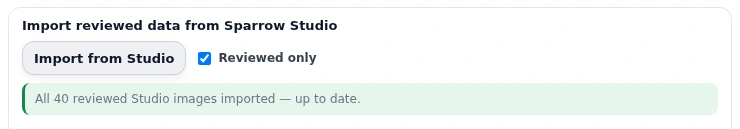

# SPARROW Fine-Tune

**Train a camera-trap model for the species and sites you monitor.** A field team might
have a season of reviewed photos and a stock classifier that keeps confusing two local
species. SPARROW Fine-Tune lets the team use those corrections as training data, then
inspect the per-species results before deciding whether to replace the stock model.
If the problem is finding animals in the frame rather than naming them, use the same
workspace to review bounding boxes and train a detector.

Fine-Tune is for wildlife researchers, conservation teams and the people who maintain
their camera-trap models. A reviewer can correct labels in a browser; a model maintainer
can train from that exact set of examples, change a setting and compare the two runs.
Neither needs to write a training script.

[Screenshots](#a-look-inside) · [Quick start](#quick-start) · [Choose a pipeline](#choose-a-pipeline) · [Studio release preview](#future-release-with-sparrow-studio) · [User manual](docs/user-manual.md)

### 🔗 Why a separate app, and how Studio fits

**This repository releases Fine-Tune as a standalone app.** If your team has a folder of
camera-trap photos or exported annotations, you can review them, train on your own hardware
and download the model without setting up a Sparrow Studio project. Studio features are
turned off in the repository release: you bring the data in and decide where the model goes.

We also plan to release the **full fine-tuning workflow with Sparrow Studio**. If your team
already reviews sightings in Studio, you’ll be able to start with that project’s reviewed
data and send a model back to the same project. [See the Studio release preview](#future-release-with-sparrow-studio).

## 📷 A look inside

### 📂 Prepare training data

[](docs/media/prepare-data.webp)

Choose the dataset and pipeline at the top. Under **Review the training examples**, confirm,
correct or exclude individual photos. The **Training snapshot** panel on the right shows
whether any crops still need boxes before you freeze the examples for a run.

### 🔍 Review an individual photo

[](docs/media/review-boxes.webp)

*Reviewing a deer annotation before training. The box and species label come from the
published dataset; they are not model predictions.*

<details>
<summary><strong>See three annotated camera-trap photographs</strong> (animated GIF)</summary>


</details>

Field photographs: [Caltech Camera Traps](https://lila.science/datasets/caltech-camera-traps/),
[CDLA-Permissive 1.0](https://cdla.dev/permissive-1-0/).
[Deer](https://storage.googleapis.com/public-datasets-lila/caltech-unzipped/cct_images/59b7a938-23d2-11e8-a6a3-ec086b02610b.jpg)
and [bobcat](https://storage.googleapis.com/public-datasets-lila/caltech-unzipped/cct_images/59aadcc0-23d2-11e8-a6a3-ec086b02610b.jpg): Justin Brown.
[Coyote](https://storage.googleapis.com/public-datasets-lila/caltech-unzipped/cct_images/58a52f6e-23d2-11e8-a6a3-ec086b02610b.jpg): Erin Boydston.

| Follow a training job | Decide what to do with a model |
|---|---|
| [](docs/media/training-job.webp) | [](docs/media/model-card.webp) |
| Check the training curves and whether export succeeded. | Check **Started from** to see whether this version began with pretrained weights, a new head or a previous classifier. |

The job and model screens show separate software test runs, not accuracy on the wildlife photographs above.

**Compare model versions.** Each successful training run creates a new version and leaves
the previous one intact. In **Models → Compare with another version**, pick the version you
use today to see its recorded validation metrics beside the candidate’s. The table compares
existing scores; it does not rerun both models on the same photos. Before switching, evaluate
both on the same held-out images and check the species that matter to your project.

**Investigate drift.** Suppose a camera moves from a forest trail to an open field and starts
missing deer. Keep the model version fixed and compare its deer recall on reviewed photos
from before and after the move: of the deer people found, how many did the model find?
A drop is a reason to inspect the missed photos. Fine-Tune does not monitor deployed models
for drift or send alerts.

## 🚀 Quick start

You need Docker with Compose v2. The CPU setup runs the web app, PostgreSQL and a training
worker on one machine. You don't need Studio or an NVIDIA GPU.

```bash
git clone https://github.com/microsoft/SPARROW-Fine-Tune.git
cd SPARROW-Fine-Tune
cp .env.service.example .env.service
```

In `.env.service`, replace `POSTGRES_PASSWORD=change-me` with a private password and add
`TORCH_VARIANT=cpu`. Keep this file local. Start the service:

```bash
docker compose -f compose.service.yml --env-file .env.service up -d --build --wait
curl -fsS http://127.0.0.1:8000/v1/health
```

Open **<http://127.0.0.1:8000/>** when the health response says `{"status":"ok","database":"ok"}`.
The default install has no DINO encoder. For a first run without one, select **Image classifier**
before creating your snapshot. Allow network access for the first ImageNet weights download,
or [mount the weights for offline use](docs/user-manual.md#3-model-weights).

> [!IMPORTANT]
> Sign-in is off by default. Keep the default loopback binding for local use. Before sharing
> the app, enable sign-in and put an HTTPS reverse proxy in front of it. Users on the same
> installation share its workspaces.

## 🧭 Choose a pipeline

| What you want to learn | Choose | What trains |
|---|---|---|
| Which species is in this animal crop? | **DINOv3 linear** (recommended with an encoder) | A new linear classification head on frozen DINO features. Once the crops have features, you can fit the head on CPU without running the encoder again. |
| Which species is in this crop or whole photo? | **Image classifier** | Fine-tune **ResNet-50** or **EfficientNet-B0** from ImageNet weights. A GPU is recommended. |
| Where are the animals in this image? | **YOLO11 detector** | Train a detector from reviewed bounding boxes. Create a **Detection** dataset to see this pipeline. A GPU is recommended. |

Use the **Model Zoo** to browse runtime models. An ONNX download lets you run predictions;
it does not supply the original training weights. For a first classifier, use one of the
starting points above. Later runs can start from a compatible classifier you trained here.

## 🧠 Train your first model

1. **Choose the task.** In **Prepare data**, create a workspace and choose **+ New dataset**.
   Select *Classification* for species labels or *Detection* for boxes. Turning off
   whole-image classification does not switch a dataset to detection.
2. **Review the images.** Upload photos and label them, or import existing COCO, Pascal VOC or
   Camtrap DP annotations. For crop classification, draw
   missing boxes or use an installed detector to propose boxes for review.
3. **Choose the pipeline, then create an immutable snapshot.** The snapshot fixes the
   examples for this run. With DINO selected, image cards show **Pending feature** or
   **Feature extracted**. The progress pane counts crops computed and reused; if all crops
   have valid features, no extraction is needed. Other pipelines skip this step.
4. **Train and inspect the result.** Start training and follow progress in **Jobs**. In
   **Models**, inspect per-class results and the confusion matrix. If you selected a stock
   classifier for comparison, check where the new classifier gained or lost accuracy.
5. **Export or iterate.** Download the ONNX bundle. To try new data or settings,
   select **Use as base for new training** on a
   finished classifier. The preview shows what transfers. The original model stays intact;
   **Started from** on the new model card identifies the parent.

## 🔭 Future release with Sparrow Studio

The planned Studio release will connect both ends of a training run to your project.
These screenshots come from a connected development build; the controls shown here
are not part of the standalone walkthrough above.

**From reviewed sightings to training examples.** Open **Model fine-tune** from your Studio
project and import the sightings your team has reviewed. You won’t need to export photos
and labels to a folder first. In this example, Fine-Tune reports that all 40 reviewed
images have been imported.

[](docs/media/studio-reviewed-import.webp)

**From a finished model back to the project.** Compare versions in Fine-Tune, select the
one you want to use, then choose **Activate in Studio**. Training a new version alone
does not change the project’s model. The status below shows that Fine-Tune has sent
the selected classifier and is waiting for Studio to install it.

[](docs/media/studio-send-model.webp)

## 🔧 Configure your installation

| Option | Setup |
|---|---|
| **DINO features** | Mount a compatible frozen encoder read-only at the same container path in the API and preparation worker. Set `SPARROW_FT_EMBEDDER=onnx:/weights/encoder.onnx` in `.env.service`, using your mounted path. The [weights mount example](docs/user-manual.md#3-model-weights) shows how to start Compose with an override. |
| **NVIDIA GPU** | Install the NVIDIA Container Toolkit, set `SPARROW_FT_GPU_PIPELINES=yolo_detector,conventional_classifier` in `.env.service`, then start the GPU profile below. Without a GPU worker, leave this setting empty. |

```bash
# Add the CUDA worker to the existing CPU installation
docker compose -f compose.service.yml --env-file .env.service --profile gpu up -d --build
```

For shared access, set `SPARROW_FT_AUTH_DISABLED=0` and, behind HTTPS,
`SPARROW_FT_COOKIE_SECURE=1`. Apply the settings and create an account. In Bash:

```bash
docker compose -f compose.service.yml --env-file .env.service up -d
read -rs -p 'New admin password: ' password; echo
printf '%s\n' "$password" | docker compose -f compose.service.yml --env-file .env.service exec -T api sparrow-finetune create-user admin
unset password
```

## 💻 Development

The FastAPI service and workers share PostgreSQL and a data volume. For the API schema,
open [interactive API docs](http://127.0.0.1:8000/docs) on your running installation.
To run the tests from source with `uv` and Docker:

```bash
uv sync --extra dev --extra export --extra e2e
uv run --no-sync playwright install chromium
uv run --no-sync python -m pytest -q tests
```

See the [user manual](docs/user-manual.md) for operations, API routes and the separate legacy
YOLO workbench. For project help, see [Support](SUPPORT.md); report security issues through
the [security policy](SECURITY.md).

## 🤝 Contributing

This project welcomes contributions and suggestions.  Most contributions require you to agree to a
Contributor License Agreement (CLA) declaring that you have the right to, and actually do, grant us
the rights to use your contribution. For details, visit [Contributor License Agreements](https://cla.opensource.microsoft.com).

When you submit a pull request, a CLA bot will automatically determine whether you need to provide
a CLA and decorate the PR appropriately (e.g., status check, comment). Simply follow the instructions
provided by the bot. You will only need to do this once across all repos using our CLA.

This project has adopted the [Microsoft Open Source Code of Conduct](https://opensource.microsoft.com/codeofconduct/).
For more information see the [Code of Conduct FAQ](https://opensource.microsoft.com/codeofconduct/faq/) or
contact [opencode@microsoft.com](mailto:opencode@microsoft.com) with any additional questions or comments.

## 📜 Trademarks

This project may contain trademarks or logos for projects, products, or services. Authorized use of Microsoft
trademarks or logos is subject to and must follow
[Microsoft's Trademark & Brand Guidelines](https://www.microsoft.com/legal/intellectualproperty/trademarks/usage/general).
Use of Microsoft trademarks or logos in modified versions of this project must not cause confusion or imply Microsoft sponsorship.
Any use of third-party trademarks or logos are subject to those third-party's policies.
